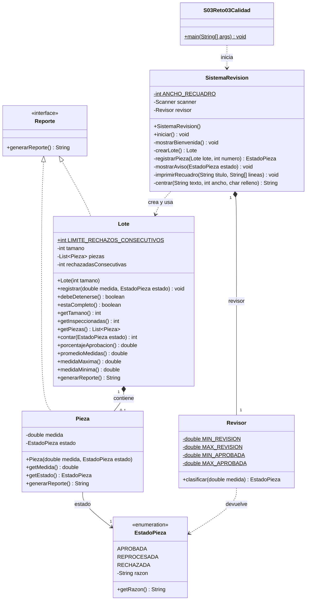
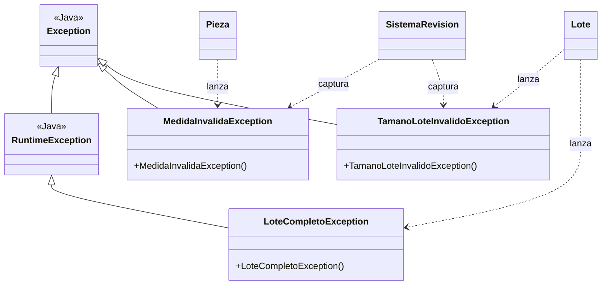
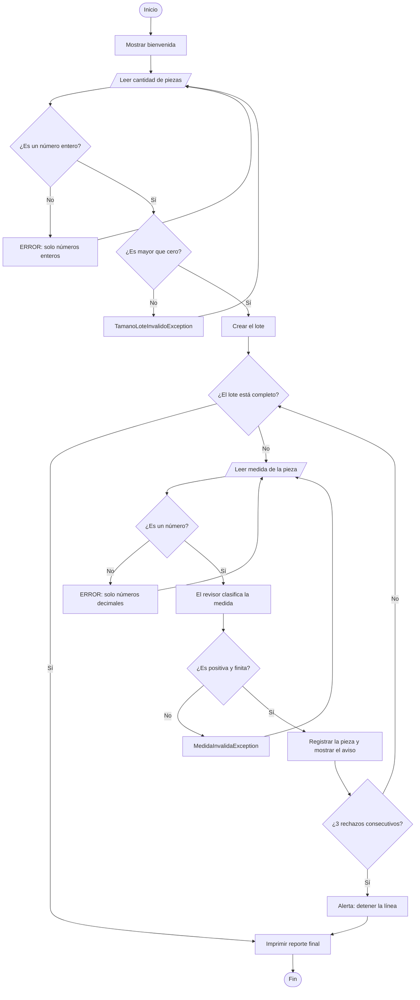
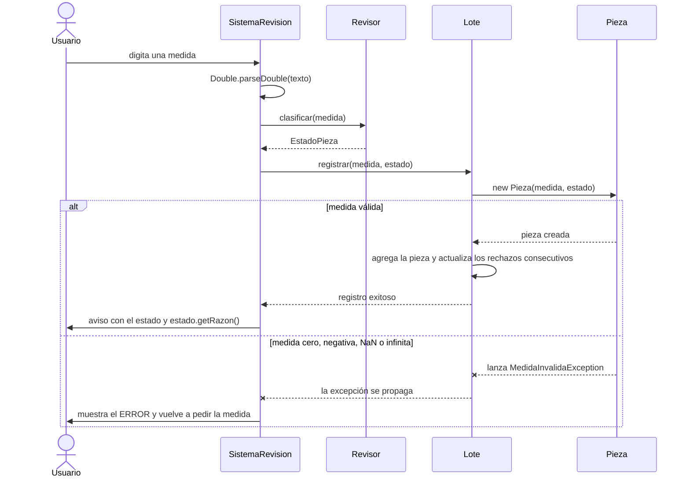

# Sistema de revisión de piezas por lotes

Versión orientada a objetos del reto de control de calidad (S03 · Reto 03). El usuario indica cuántas piezas trae un lote, digita la medida de cada una y el sistema decide si se aprueba, se reprocesa o se rechaza. Al final genera un reporte con las estadísticas del lote.

## Reglas de calidad

| Estado | Rango (mm) |
|---|---|
| `APROBADA` | 9.8 a 10.2 |
| `REPROCESADA` | 9.5 a menos de 9.8, o más de 10.2 a 10.5 |
| `RECHAZADA` | Menos de 9.5 o más de 10.5 |

El tamaño del lote debe ser mayor que cero y cada medida debe ser positiva y finita. Si hay **3 rechazos consecutivos**, la línea se detiene y se genera el reporte con lo inspeccionado hasta ese momento.

## Ejecución

Requiere **JDK 17 o superior**.

```bash
javac -encoding UTF-8 *.java
java S03Reto03Calidad
```

Las medidas se pueden digitar con punto o con coma (`9.6` o `9,6`).

## Estructura

```text
.
├── S03Reto03Calidad.java            → Main
├── SistemaRevision.java             → Consola y coordinación del proceso
├── Revisor.java                     → Reglas de calidad: medida → estado
├── Lote.java                        → Piezas, rechazos consecutivos y estadísticas
├── Pieza.java                       → Medida y estado de una pieza
├── EstadoPieza.java                 → Enum de estados con su razón
├── Reporte.java                     → Interfaz de reporte
├── MedidaInvalidaException.java
├── TamanoLoteInvalidoException.java
└── LoteCompletoException.java
```

## Diagrama de clases



| Relación | Tipo | Motivo |
|---|---|---|
| `Pieza`, `Lote` → `Reporte` | Realización | Implementan la interfaz |
| `Lote` → `Pieza` | Composición | El lote crea sus piezas en `registrar()` |
| `Pieza` → `EstadoPieza` | Asociación | Atributo `estado` |
| `SistemaRevision` → `Revisor` | Composición | Lo crea en su constructor y nadie más lo tiene |
| `SistemaRevision` → `Lote` | Dependencia | Variable local, no atributo |
| `Revisor` → `EstadoPieza` | Dependencia | Solo lo devuelve |
| `S03Reto03Calidad` → `SistemaRevision` | Dependencia | Variable local en `main` |

## Excepciones



| Excepción | Tipo | Cuándo ocurre | Quién la maneja |
|---|---|---|---|
| `MedidaInvalidaException` | Checked | Medida cero, negativa, `NaN` o infinita | `SistemaRevision`: vuelve a pedir la medida |
| `TamanoLoteInvalidoException` | Checked | Tamaño cero o negativo | `SistemaRevision`: vuelve a pedir el tamaño |
| `LoteCompletoException` | Unchecked | Registrar en un lote ya completo | Nadie: es un error de programación |
| `NumberFormatException` | Unchecked (Java) | El texto no es un número | `SistemaRevision` |

Las *checked* son errores del usuario, de los que el programa se recupera. La *unchecked* solo puede ocurrir por un error en el código, por eso no se captura.

## Flujo del programa



## Secuencia al registrar una pieza



## Decisiones de diseño

- **Enum en vez de booleanos:** una sola variable de estado, y cada estado trae su razón.
- **Sin contadores:** los totales y estadísticas se calculan desde la lista de piezas, así nunca se desincronizan. Solo `rechazadasConsecutivas` es contador, porque depende de la secuencia.
- **Atributo `tamano`:** es el tamaño declarado; `piezas.size()` es lo inspeccionado. Si la línea se detiene, el reporte muestra, por ejemplo, "5 de 6".
- **`Pieza` inmutable:** atributos `final`, validados en el constructor y sin setters.
- **`Locale.ROOT`:** los decimales siempre salen con punto, sin importar el idioma del equipo.

## Ejemplo de reporte

```text
================REPORTE FINAL================
TAMAÑO DEL LOTE: 6
Pieza 1: 10.0 | APROBADA
Pieza 2: 9.6 | REPROCESADA
Pieza 3: 11.0 | RECHAZADA
Pieza 4: 12.0 | RECHAZADA
Pieza 5: 10.6 | RECHAZADA
---------------------------------------------
PIEZAS APROBADAS: 1
PIEZAS REPROCESADAS: 1
PIEZAS RECHAZADAS: 3
TOTAL DE PIEZAS INSPECCIONADAS: 5 de 6
PORCENTAJE DE APROBACIÓN: 20.00%
PROMEDIO DE MEDIDAS: 10.64
---------------------------------------------
MEDIDA MÁXIMA: 12.0
MEDIDA MÍNIMA: 9.6
=============================================
```
